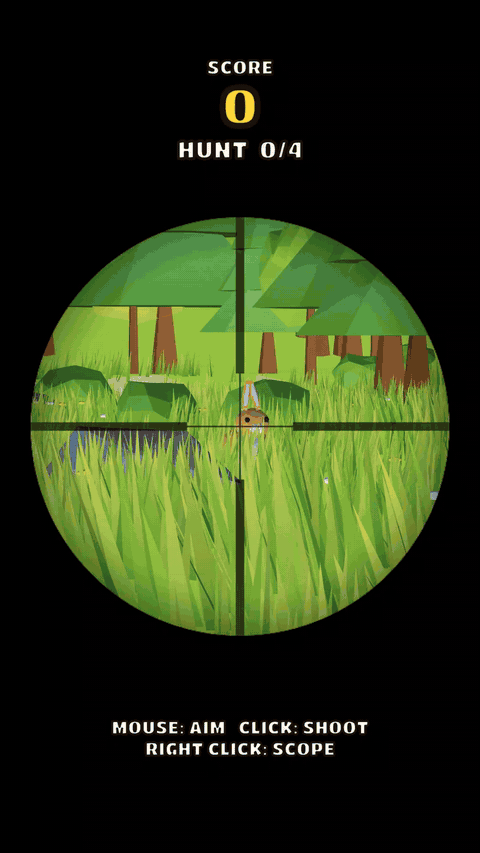
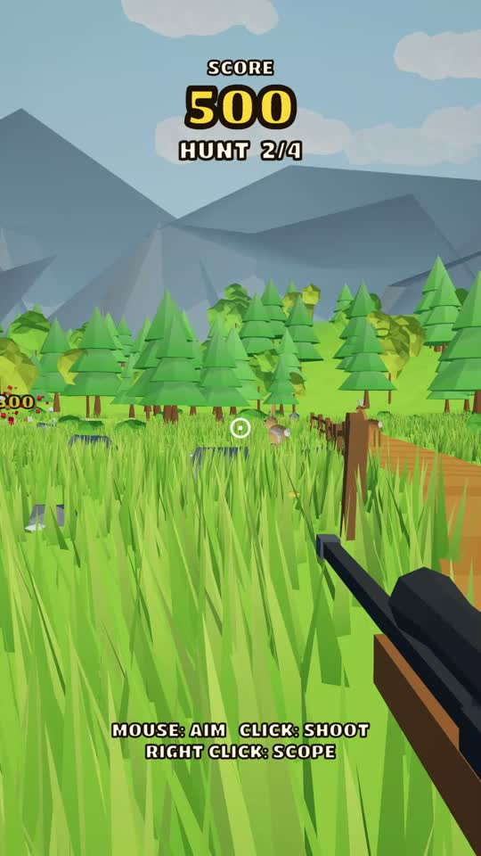
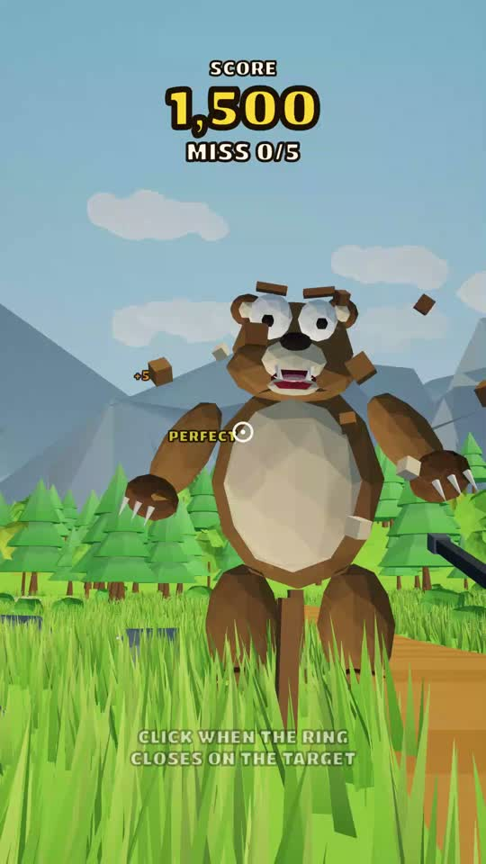

# Grizzle Valley

Scope a few critters in a sunny low-poly meadow, then a huge, googly-eyed bear stumbles in. He looks scary. He is not.

 

## How to play

- **Mouse**: aim. **Left click**: shoot. **Hold right click**: scope in (hunting only).
- **Hunt**: shoot 4 critters (bunny-like Puffhops 200 points, deer-like Antlerkins 300).
- **Big Mumbles**: he rears up and roars. Orange targets appear on his face, belly and paws with a shrinking white ring. Put the crosshair on the target and click when the ring closes (a PERFECT is worth 500, GOOD 300).
- Hit 6 rings and he sits down happy. Miss 5 and he gives you a big hug. The game restarts by itself.

## How to open it

Unity `6000.5.4f1` (URP, Input System). Open the folder as a project, open `Assets/GrizzleValley/Scenes/GrizzleValley.unity` and press Play. Everything (world, animals, bear, rifle, effects) is built from code and primitives at start, so there are no imported models. The Satura Space handles in the code are guarded by `#if UNITY_EDITOR && SATURA_SPACE`, so the project opens and plays in plain Unity.

## Created by Satura Space

This game was made with [Satura Space](https://github.com/saturadev/satura-space) ([saturaspace.com](https://saturaspace.com)), which is free and open source. A TikTok link (inspired by [@butterssensei](https://www.tiktok.com/@butterssensei/video/7700991212458675463)) was pasted into Satura Space. A Claude agent watched the clip's frames, searched GitHub for how others solved the core mechanics, built the game in Unity, playtested it with a bot and filmed it.

## Model and cost

Claude Opus 5.5 (with Claude Sonnet 5.5 for part of the run), in Claude Code. At Anthropic API list prices the run would have cost about **$4.70** (estimate): Opus 5.5 about $3.13 (74.6k output tokens, 3.14M cache-read, 126k cache-write), Sonnet 5.5 about $1.58 (28.8k output tokens, 6.44M cache-read, 161k cache-write).

## Credits

- [llamacademy/scriptable-object-based-guns](https://github.com/llamacademy/scriptable-object-based-guns) (MIT): the tracer and recoil-recovery technique, re-written here.
- Font: Titan One by Rodrigo Fuenzalida, SIL Open Font License 1.1.
- Inspired by the TikTok clip by [@butterssensei](https://www.tiktok.com/@butterssensei/video/7700991212458675463). No footage of it is in this repo.

Code and art: MIT, see `LICENSE`.
